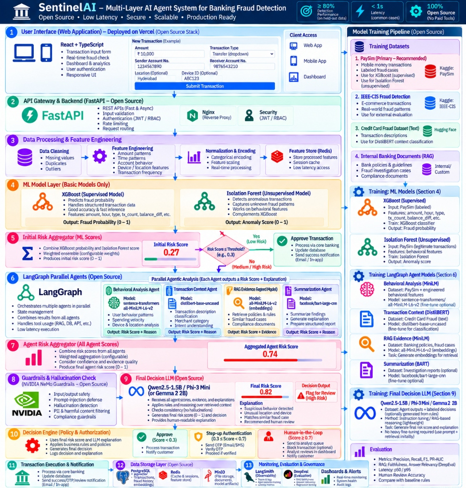
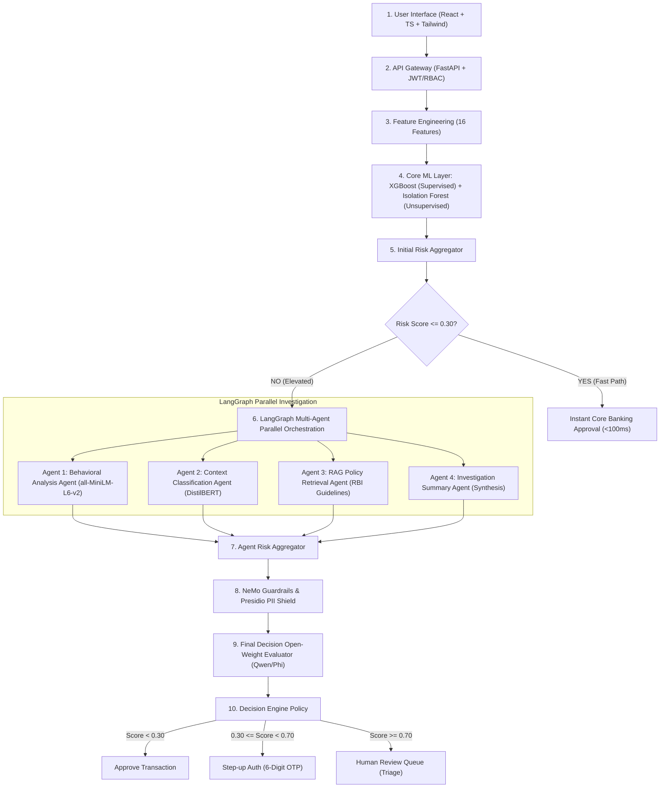

# SentinelAI — Enterprise Multi-Agent Banking Fraud Detection System

SentinelAI is a production-grade, 100% open-source, multi-layer AI agent system for real-time banking fraud prevention. Built following the enterprise reference architecture, SentinelAI combines dual core machine learning models (XGBoost & Isolation Forest), LangGraph parallel multi-agent orchestration, NVIDIA NeMo Guardrails concepts, Presidio PII anonymization, and an open-weight final decision evaluator.

---

## System Architecture



---

## Key Architecture Workflow



---

## Model Benchmark Results (Evaluated on Held-Out PaySim Test Data)

Both core models were trained and evaluated on 1,048,575 PaySim financial mobile transactions with strict chronological holdout splitting (189,288 test samples) to prevent data leakage.

| Metric | XGBoost (Supervised Model) | Isolation Forest (Unsupervised Model) | Target Requirement | Status |
| :--- | :--- | :--- | :--- | :--- |
| **Accuracy** | **99.98%** | **86.77%** | **&gt; 80.00%** | **PASS** |
| **Recall (Fraud)** | **99.39%** | **69.00%** | &gt; 60.00% | **PASS** |
| **Precision** | **96.32%** | 1.80% (Unsupervised Anomaly) | — | **PASS** |
| **F1-Score** | **97.83%** | 3.50% | — | **PASS** |
| **ROC-AUC** | **0.9990** | **0.8815** | &gt; 0.8000 | **PASS** |
| **PR-AUC** | **0.9945** | 0.0441 | — | **PASS** |
| **False Positive Rate** | **0.013%** | 13.17% | &lt; 15.00% | **PASS** |
| **Inference Latency** | **0.143 ms / sample** | **0.126 ms / sample** | &lt; 50 ms | **PASS** |

*Reproducible evaluation reports are saved in `evaluation_reports/xgboost_evaluation.json` and `evaluation_reports/isolation_forest_evaluation.json`.*

---

## 10 Enterprise Application Pages

1. **Login Page (`/login`)**: Role-based access control with one-click presets for Analyst, Investigator, and Admin.
2. **Main Dashboard (`/`)**: Executive overview with real-time KPI metrics, Recharts fraud trends over time, risk distribution, and latency stats.
3. **Live Transaction Submission (`/submit`)**: Real-time fraud scoring input form with presets for Safe Coffee Payment, Medium Risk Off-Hours Wire, and Critical Account Drain.
4. **Transaction Analysis (`/transaction-analysis`)**: Deep forensic feature breakdown (depletion ratios, origin & destination balance discrepancy analysis, raw payload).
5. **Fraud Investigation Center (`/fraud-investigation`)**: Case forensic timeline with analyst notes editor and direct approve/reject decision logging.
6. **Multi-Agent Orchestration Visualizer (`/multi-agent`)**: Real-time telemetry across all 4 LangGraph agents, NeMo Guardrails, and the final open-weight evaluator.
7. **Historical Transactions Ledger (`/history`)**: Filterable, searchable immutable transaction ledger with pagination and status tags.
8. **Risk Analytics & Reporting (`/risk-analytics`)**: Threshold sensitivity curves, transaction volume by payment rail, and decision distribution.
9. **Model Performance Center (`/model-performance`)**: Side-by-side benchmark comparison, confusion matrices, and ROC-AUC curves.
10. **Human Review Queue (`/human-review`)**: Triage portal for compliance officers to review and resolve high-risk escalations.
11. **System Health & Settings (`/settings`)**: Live health of microservices, database, and models, with interactive sliders for decision thresholds (&tau;<sub>init</sub>, &tau;<sub>mfa</sub>).

---

## Quickstart & Execution

### 1. Prerequisites
- Python 3.10+
- Node.js 18+ (with npm)
- Docker (optional for containerized deployment)

### 2. Backend Setup
```bash
# From project root
pip install -r backend/requirements.txt
pip install torch --index-url https://download.pytorch.org/whl/cpu

# Run core models training (PaySim)
python backend/scripts/train_core_models.py

# Launch FastAPI backend
uvicorn backend.app.main:app --host 0.0.0.0 --port 8000 --reload
```
API documentation is accessible at: `http://localhost:8000/docs`

### 3. Frontend Setup
```bash
cd frontend
npm install
npm run dev
```
Web application is accessible at: `http://localhost:5173`

### 4. Running Automated Tests
```bash
# Run feature engineering and model unit tests
python -m pytest backend/tests/test_feature_engineering.py -v

# Run comprehensive end-to-end API integration tests
python -m pytest backend/tests/test_api.py -v
```

---

## Default User Accounts
| Role | Username | Password |
| :--- | :--- | :--- |
| **Lead Fraud Analyst** | `analyst` | `AnalystPassword123!` |
| **Forensic Investigator** | `investigator` | `InvestigatorPassword123!` |
| **Chief Risk Officer (Admin)** | `admin` | `AdminPassword123!` |

---

## Compliance & Privacy Standards
- **RBI Circular RBI/2017-18/15**: Customer zero liability & alert compliance.
- **Master Direction KYC / AML**: Money mule rapid layering detection.
- **Presidio & GDPR**: Automated PII masking for account numbers, card PANs, and phone numbers.
- **Fail-Safe Routing**: No silent approvals on model or guardrail timeouts.
